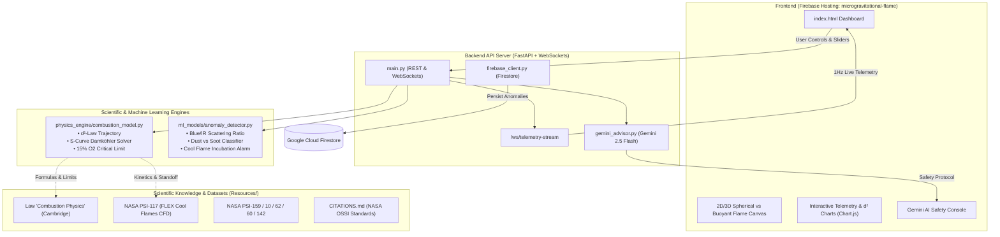

# 🔥 Flame in Freefall: AI-Powered Fire Safety Insights from Microgravity Combustion Data
**NASA International Space Apps Challenge** | **Team Sisyphus**  
**Target Missions & Facilities:** International Space Station (ISS CIR / MDCA / ACME) & Future Lunar/Martian Habitats (Gateway, Artemis Base Camp)  
**Firebase Production Project:** `microgravitational-flame`  
**GitHub Repository:** [https://github.com/KarenGhardashyan/flame-in-freefall.git](https://github.com/KarenGhardashyan/flame-in-freefall.git)

---

## 🌟 Executive Summary
In terrestrial gravity ($1g$), buoyancy forces ($F_b \propto g(\rho_\infty - \rho_b)$) drive hot combustion products into an ascending thermal plume, allowing ceiling-mounted optical and ionization smoke detectors to reliably alert occupants. 

In microgravity ($0g$), **buoyancy is virtually eliminated**. Flames form spherical diffusion envelopes governed strictly by molecular transport, burning at lower burning rates with higher standoff distances ($r_f/r_s \approx 8 - 12$). Conventional ceiling detectors fail completely because smoke does not rise. Furthermore, quiescent microgravity conditions allow radiative heat loss to trigger **cool flame transitions** (NASA PSI-117) — low-temperature ($600 - 800\text{ K}$) combustion zones that emit zero visible light yet continue to consume fuel and generate toxic CO.

**Flame in Freefall** integrates:
1. **Microgravity Physics Engine:** Mathematical modeling of droplet burning via the classical $d^2$-law, Spalding transfer numbers, Damköhler number $Da$ limit phenomena (S-Curve), and Chung K. Law's $15\%$ $O_2$ spacecraft flammability threshold.
2. **0g False-Alarm Rejection & Early Fire Detector:** Dual-wavelength optical scattering discrimination that filters out suspended cabin lint/dust transported by HVAC loops while detecting genuine submicron soot and smoldering CO excursions.
3. **Gemini AI Spacecraft Safety Officer:** Multi-modal cognitive reasoning agent delivering real-time NASA Flight Rule emergency response protocols.
4. **Interactive Mission Control Dashboard:** 2D/3D spherical vs buoyant flame canvas renderer, dynamic phase diagrams, and real-time telemetry streaming for Firebase Hosting.

---

## 🏗 System Architecture



---

## 📁 Repository Directory Structure

```text
flame-in-freefall/
├── backend/                # FastAPI application server
│   ├── main.py             # REST API, WebSockets streaming, static mounting
│   ├── firebase_client.py  # Firestore / Realtime Database client with local fallback
│   └── gemini_advisor.py   # Gemini AI prompt orchestration & NASA flight rules engine
├── physics_engine/         # Microgravity combustion numerical models
│   ├── __init__.py
│   └── combustion_model.py # d^2-law, Spalding B number, S-curve, flammability limits
├── ml_models/              # Spacecraft fire anomaly detection
│   ├── __init__.py
│   └── anomaly_detector.py # 0g false alarm rejection (dust vs soot) & early detector
├── frontend/               # Mission Control Web Dashboard (Firebase Hosting)
│   └── index.html          # Interactive GUI, Canvas flame simulation, Chart.js
├── Resources/              # Research papers, formulas, and NASA PSI datasets
│   ├── Law_Combustion_Physics.pdf     # Monograph by Chung K. Law (Cambridge)
│   ├── physics_formulas_summary.md    # Formulations, constants & flammability limits
│   ├── CITATIONS.md                   # Open-source science DOIs & citations
│   └── nasa_psi/                      # NASA PSI-117/159/10/62/60/142 assets & guides
├── KarenGhardashyan/       # R&D Sandbox: Lead & System Architect (Branch: dev-karen)
├── AshkanAshkani/          # R&D Sandbox: Combustion Physics & Modeling (Branch: dev-ashkan)
├── LalaMargaryan/          # R&D Sandbox: Frontend & Visualization (Branch: dev-lala)
├── scripts/                # Extraction and scraping utilities
│   ├── extract_knowledge.py           # Cambridge PDF formula parser
│   └── download_nasa_psi.py           # NASA PSI data & guide downloader
├── firebase.json           # Firebase Hosting configuration
├── .firebaserc             # Firebase project binding (microgravitational-flame)
├── requirements.txt        # Python dependency manifest
└── README.md               # Master system documentation
```

---

## 🚀 Quick Start Guide

### 1. Python Environment Setup
Ensure Python 3.10+ is installed:
```bash
# Clone the repository
git clone https://github.com/KarenGhardashyan/flame-in-freefall.git
cd flame-in-freefall

# Create and activate virtual environment
python -m venv venv
# On Windows:
.\venv\Scripts\activate
# On Linux/macOS:
source venv/bin/activate

# Install dependencies
pip install -r requirements.txt
```

### 2. Launching the Backend Server
```bash
uvicorn backend.main:app --host 0.0.0.0 --port 8000 --reload
```
API documentation is interactively accessible at:
* Swagger UI: [http://localhost:8000/docs](http://localhost:8000/docs)
* Redoc: [http://localhost:8000/redoc](http://localhost:8000/redoc)

### 3. Deploying / Previewing Frontend via Firebase
```bash
# Preview locally
firebase serve --only hosting

# Deploy to live production hosting (microgravitational-flame.web.app)
firebase deploy --only hosting
```

---

## 👥 Git Collaboration & Team Workflow

To prevent merge conflicts and maintain high codebase velocity, all team members follow the branch workflow:

| Team Member | Role | Dedicated Branch | Sandbox Directory |
|---|---|---|---|
| **Karen Ghardashyan** | Team Lead & System Architect | `dev-karen` | `KarenGhardashyan/` |
| **Ashkan Ashkani** | Combustion Physics Specialist | `dev-ashkan` | `AshkanAshkani/` |
| **Lala Margaryan** | Frontend & Visualization Specialist | `dev-lala` | `LalaMargaryan/` |

### Rules of Engagement:
1. **Never commit directly to `main`:** All prototyping must occur in your dedicated `dev-*` branch.
2. **Keep branches updated:** Before opening a PR or merging, pull the latest changes from `main`:
   ```bash
   git checkout dev-yourname
   git fetch origin
   git merge origin/main
   ```
3. **Module Promotion:** Core algorithms developed in your sandbox (`KarenGhardashyan/`, `AshkanAshkani/`, `LalaMargaryan/`) should be promoted to the production folders (`backend/`, `physics_engine/`, `ml_models/`, `frontend/`) via pull requests.

---

## 📜 Scientific References & Acknowledgments
All scientific derivations, constants, and experimental validations are cited in [`Resources/CITATIONS.md`](Resources/CITATIONS.md), honoring NASA's Open Source Science Initiative (OSSI) standards:
- **NASA PSI-117:** FLEX Cool Flames CFD (DOI: `10.60555/gz0q-b577`)
- **NASA PSI-159:** ACME CFI-G (Cool Flames Investigation with Gases)
- **Chung K. Law:** *Combustion Physics*, Cambridge University Press (2006).
