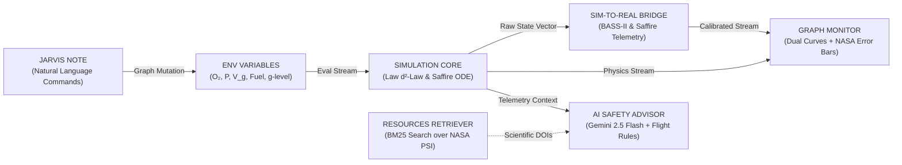

# 🔥 Flame in Freefall: AI-Powered Spacecraft Fire Safety & Microgravity Combustion Engine

**NASA International Space Apps Challenge 2024** | **Team Sisyphus**  
**Production Live URL:** [https://microgravitational-flame.web.app](https://microgravitational-flame.web.app)  
**GitHub Repository:** [https://github.com/KarenGhardashyan/flame-in-freefall.git](https://github.com/KarenGhardashyan/flame-in-freefall.git)  
**Target Spacecraft & Facilities:** International Space Station (ISS CIR / MDCA / ACME / BASS-II), Cygnus (Saffire-I–VI), Gateway, and Artemis Lunar/Martian Habitats.

---

## 🌟 Executive Summary

In terrestrial normal gravity ($1g$), buoyancy forces driven by density gradients:
$$F_b \propto g \cdot (\rho_\infty - \rho_b)$$
sweep hot combustion products upward into a buoyant thermal plume. In microgravity ($\mu g \approx 0$), **buoyancy is virtually eliminated**. Flames form symmetric, spherical diffusion envelopes governed strictly by molecular transport, burning at reduced mass consumption rates with dramatically increased flame standoff distances:
$$\frac{r_f}{r_s} \approx 8 - 15$$

Conventional ceiling-mounted smoke detectors fail catastrophically in $0g$ because smoke does not rise. Furthermore, quiescent microgravity conditions enhance radiative heat loss from soot, triggering **cool flame transitions** (NASA PSI-117 / FLEX) — low-temperature ($600 - 800\text{ K}$) quasi-steady combustion regimes that emit zero visible radiation yet continuously consume onboard oxygen and emit toxic carbon monoxide ($CO$).

**Flame in Freefall** bridges theoretical combustion physics, empirical flight telemetry from NASA missions (BASS-II, Saffire, FLEX, ACME), and autonomous AI control into a real-time **Mission Control Blueprint Dashboard** designed with a minimal SpaceX Telemetry aesthetic.

---

## 🧮 Theoretical & Mathematical Formulations

### 1. Quasi-Steady Droplet Combustion ($d^2$-Law)
Under spherical symmetry in microgravity, the droplet diameter regression follows the classical Law & Williams formulation:
$$d^2(t) = d_0^2 - K \cdot t$$

Where the burning rate constant $K$ is determined by transport properties and the thermodynamic Spalding mass transfer number $B$:
$$K = \frac{8 \lambda_g}{\rho_l c_{p,g}} \ln(1 + B)$$

The Spalding transfer number $B$ incorporates both thermal convection and oxygen mass fraction $Y_{O_2,\infty}$:
$$B = \frac{\frac{Y_{O_2,\infty} \Delta H_c}{\nu_{O_2} W_{O_2}} + c_{p,g}(T_\infty - T_s)}{L_v + \frac{\dot{Q}_{rad}}{\dot{m}_f}}$$

Where:
* $d_0$: initial fuel droplet diameter ($\text{mm}$)
* $\lambda_g$: gas-phase thermal conductivity ($\text{W}/(\text{m}\cdot\text{K})$)
* $\rho_l$: liquid fuel density ($\text{kg}/\text{m}^3$)
* $c_{p,g}$: specific heat capacity of gas ($\text{J}/(\text{kg}\cdot\text{K})$)
* $L_v$: latent heat of fuel vaporization ($\text{J}/\text{kg}$)
* $\Delta H_c$: heat of combustion ($\text{J}/\text{kg}$)

---

### 2. Solid Material Flammability & Opposed-Flow Flame Spread (NASA BASS-II)
For solid spacecraft combustibles (PMMA, Nomex, Sibal fabric) under forced cabin ventilation velocity $V_g$, the flame spread rate $V_f$ is governed by thermal Peclet number and oxygen availability:
$$V_f = V_{f,0} \left(\frac{Y_{O_2} - Y_{O_2,ext}}{Y_{O_2,ref} - Y_{O_2,ext}}\right)^n \cdot f(V_g)$$

The flammability boundary obeys Chung K. Law's critical spacecraft oxygen threshold:
$$Y_{O_2,crit} \approx 15.0\% \quad (0.15 \text{ mol/mol})$$
When $Y_{O_2} < 0.15$ or Damköhler number $Da < Da_{ext}$, vigorous gas-phase combustion is thermodynamically unviable, leading to extinction or transition into smoldering.

---

### 3. Large-Scale Spacecraft Cabin Heat & Pressure Dynamics (NASA Saffire-I–VI)
Cabin thermal response is modeled as an open lumped capacitance system with sub-step numerical integration ($\Delta t_{sub} = 0.25\text{ s}$):
$$\frac{dT_{cabin}}{dt} = \frac{\dot{Q}_{comb} - \dot{Q}_{rad} - h_{eff} A_{hull}(T_{cabin} - T_{space})}{M_{air} c_v}$$

Where:
$$\dot{Q}_{comb} = \dot{m}_f \Delta H_c \cdot \eta_{comb}$$
$$\dot{Q}_{rad} = \varepsilon \sigma A_{flame} (T_f^4 - T_{cabin}^4)$$

Cabin pressure response $P(t)$ obeys the real gas thermodynamic state equation:
$$P(t) = \frac{n_{air}(t) \cdot R \cdot T_{cabin}(t)}{V_{cabin}} + \Delta P_{blast}$$

Where $\Delta P_{blast} > 0$ triggers exclusively during flammable premixed gas deflagrations (e.g., $H_2 \ge 4.0\%$ or $CH_4 \ge 5.0\%$).

---

### 4. S-Curve & Damköhler Limit Phenomena
The transition between vigorous burning, cool flame incubation, and radiative extinction is characterized by the Damköhler number $Da$:
$$Da = \frac{\tau_{flow}}{\tau_{chem}} = \frac{L / V_g}{A^{-1} \exp\left(\frac{E_a}{R T_f}\right) \cdot \rho^n Y_F^a Y_{O_2}^b}$$

* **Upper Branch ($Da > Da_{ign}$):** Vigorous hot-flame combustion ($T_f \approx 1800 - 2300\text{ K}$).
* **Middle Branch:** Unstable transition zone with hysteresis.
* **Cool Flame Branch ($Da_{ext,rad} < Da < Da_{ext,hot}$):** Low-temperature chemical oxidation ($T_f \approx 600 - 850\text{ K}$).
* **Extinction Regime ($Da < Da_{ext,kin}$):** Complete blowout due to convective blow-off or radiative freezing.

---

### 5. NASA Sim-to-Real Multi-Criteria Correlation
Simulated state vectors are mapped to the empirical NASA flight library (35+ runs from BASS-II, Saffire-I–VI, FLEX, ACME, and historical missions):
$$\mathcal{D} = \sqrt{\sum_{k} w_k \cdot \left(\frac{p_{sim,k} - p_{nasa,k}}{\sigma_k}\right)^2}$$

The confidence percentage is computed via an exponential metric:
$$\text{Confidence } \% = \min\left(99.4\%,\, 100.0 \cdot \exp(-0.55 \cdot \mathcal{D})\right)$$

Supported matching criteria:
* **Physics Criterion:** Weights oxygen fraction $Y_{O_2}$, cabin pressure $P$, ventilation speed $V_g$, and fuel chemistry.
* **Safety Criterion:** Prioritizes peak temperature excursion $T_{max}$, radiative emission, hazard classification, and suppression protocol.
* **Telemetry Criterion:** Direct $L_2$-norm over time-series heat release and pressure profiles.

---

## 🛰 Blueprint Mission Control Dashboard Architecture



### Dashboard Core Nodes:
1. **ENV VARIABLES:** Interactive controls for oxygen ($10 - 40\%$), pressure ($0.2 - 2.0\text{ atm}$), ventilation flow ($0 - 40\text{ cm/s}$), fuel selection (PMMA, Sibal, Heptane, Methane, Hydrogen), and flight presets (Apollo 1, Apollo 13, ISS Saffire-V, BASS-II, Lunar Habitat).
2. **SIMULATION CORE:** 2D canvas showing spherical microgravity flame vs buoyant plume, temperature gradient, and real-time numerical solvers.
3. **SIM-TO-REAL BRIDGE:** Multi-criteria weighted distance matcher against 35+ real NASA spaceflight runs with selectable active benchmark.
4. **AI ADVISOR:** Gemini-powered flight safety officer that delivers structured emergency protocols according to NASA Flight Rules (Caution & Warning, Depressurization, Halon/CO₂ flooding).
5. **GRAPH MONITOR:** Canvas renderer displaying dual curves (`SIM RAW` dashed line, `SIM CALIBRATED` solid cyan line) with empirical NASA scatter points and $\pm \sigma$ error bars.
6. **RESOURCES RETRIEVER:** Fast local BM25 indexing over Cambridge monographs, NASA TM reports, and PSI repository DOIs.

---

## 💻 Tech Stack & Deployment

* **Frontend:** Vanilla ES6+, HTML5 Canvas, SVG wire routers, Chart-less custom high-performance rendering. Hosted on **Firebase Hosting**.
* **Physics Core:** Pure Python scientific formulations (NumPy, SciPy, analytical ODE solvers).
* **Backend:** FastAPI, Uvicorn, WebSockets, BM25 local indexing, Google GenAI SDK.
* **Hosting URL:** [https://microgravitational-flame.web.app](https://microgravitational-flame.web.app)

---

## 🚀 Quick Start Guide

### 1. Clone & Setup
```bash
git clone https://github.com/KarenGhardashyan/flame-in-freefall.git
cd flame-in-freefall

python -m venv venv
# On Windows:
.\venv\Scripts\activate
# On Linux/macOS:
source venv/bin/activate

pip install -r requirements.txt
```

### 2. Run Backend & Dashboard Locally
```bash
python backend/main.py 5000
```
Open [http://localhost:5000](http://localhost:5000) in your browser.

### 3. Deploy Frontend to Firebase Hosting
```bash
firebase deploy --only hosting
```
Or run the automated deployment script on Windows:
```cmd
deploy.bat
```

---

## 📜 Scientific References & Citations
* **Chung K. Law:** *Combustion Physics*, Cambridge University Press (2006).
* **NASA BASS-II:** *Burning and Suppression of Solids - II*, NASA TM-20210011385.
* **NASA Saffire:** *Spacecraft Fire Safety Experiments I–VI*, ICES-2024-310.
* **NASA PSI-117:** *Flame Extinction Experiment (FLEX / Cool Flames)*.
* **NASA PSI-159:** *Advanced Combustion via Microgravity Experiments (ACME)*.
* Full citations and open DOIs available in [Resources/CITATIONS.md](Resources/CITATIONS.md).
